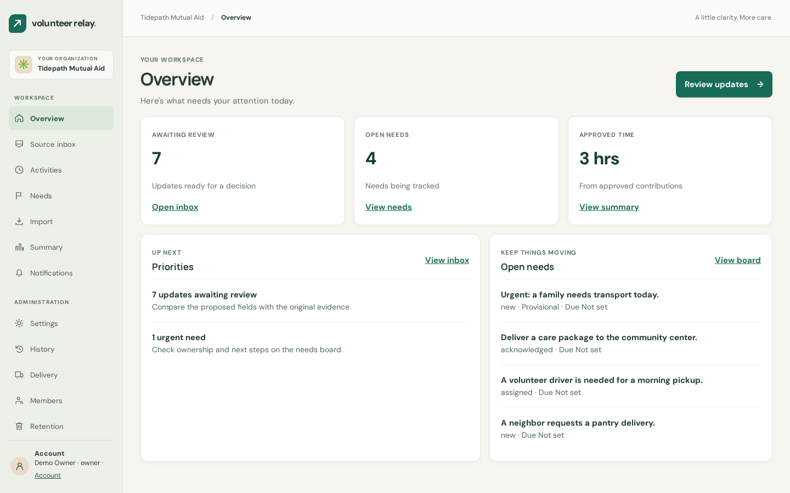

# Product UI revamp — screenshot gallery

Production-image screenshots from `ba21950`, captured on 2026-11-08 using the opt-in synthetic demo. The private local image ran as the unprivileged Node user with a read-only root filesystem; health/readiness returned 200. No live extraction or external delivery was enabled. The starting report is 180 approved minutes, three contributions and two activities, with unknown time excluded.

| Screen                    | Desktop                                                     | Mobile                                                            |
| ------------------------- | ----------------------------------------------------------- | ----------------------------------------------------------------- |
| Overview                  | [1440px](evidence/2026-11-08-revamp/overview-desktop.png)   | [390px](evidence/2026-11-08-revamp/overview-mobile.png)           |
| Selected inbox review     | [1440px](evidence/2026-11-08-revamp/inbox-desktop.png)      | [390px](evidence/2026-11-08-revamp/inbox-mobile.png)              |
| Needs board               | [1440px](evidence/2026-11-08-revamp/needs-desktop.png)      | [390px](evidence/2026-11-08-revamp/needs-mobile.png)              |
| Reports                   | [1440px](evidence/2026-11-08-revamp/reports-desktop.png)    | [390px](evidence/2026-11-08-revamp/reports-mobile.png)            |
| Activity ledger           | [1440px](evidence/2026-11-08-revamp/activities-desktop.png) | —                                                                 |
| Volunteer update history  | —                                                           | [390px](evidence/2026-11-08-revamp/volunteer-mobile.png)          |
| Opened volunteer evidence | —                                                           | [390px](evidence/2026-11-08-revamp/volunteer-evidence-mobile.png) |
| Delivery details          | —                                                           | [390px](evidence/2026-11-08-revamp/delivery-mobile.png)           |

The HTML prototype remains unchanged at [design/reference/prototype.html](../../design/reference/prototype.html). See the [comparison and verification](product-parity.md) for intentional differences and test scope. Captures contain fictional data only. Authentication and organization selection used real session endpoints; no review, invitation, preference, role or redaction was submitted during the visual walkthrough.

