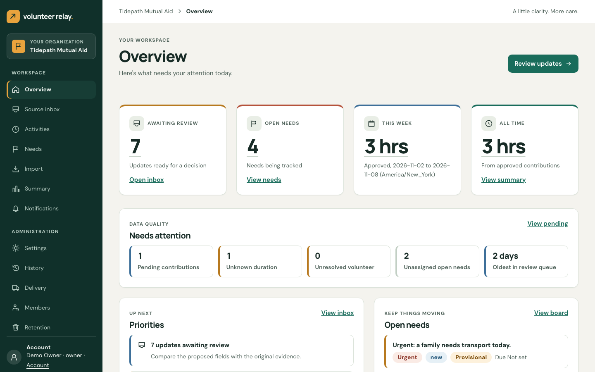

# Product UI revamp — screenshot gallery

Screenshots retaken on 2026-11-08 from `main` at `3b398ea` against the opt-in synthetic demo seed, using the Next.js development server with `DEMO_MODE=true` (demo mode is refused in production builds). Captured with Chromium at 1440px desktop and 390px mobile; the development indicator was hidden and tall pages were captured at full height. No live extraction or external delivery was enabled. The starting report is 180 approved minutes, three contributions and two activities, with unknown time excluded. The earlier production-image set from `ba21950` remains in [evidence/2026-11-08-revamp](evidence/2026-11-08-revamp/) for history; the demo-only “Replay a sample message” panel appears in the inbox capture because demo mode was on.

| Screen                    | Desktop                                                     | Mobile                                                            |
| ------------------------- | ----------------------------------------------------------- | ----------------------------------------------------------------- |
| Overview                  | [1440px](evidence/2026-11-08-retake/overview-desktop.png)   | [390px](evidence/2026-11-08-retake/overview-mobile.png)           |
| Selected inbox review     | [1440px](evidence/2026-11-08-retake/inbox-desktop.png)      | [390px](evidence/2026-11-08-retake/inbox-mobile.png)              |
| Needs board               | [1440px](evidence/2026-11-08-retake/needs-desktop.png)      | [390px](evidence/2026-11-08-retake/needs-mobile.png)              |
| Reports                   | [1440px](evidence/2026-11-08-retake/reports-desktop.png)    | [390px](evidence/2026-11-08-retake/reports-mobile.png)            |
| Activity ledger           | [1440px](evidence/2026-11-08-retake/activities-desktop.png) | —                                                                 |
| Volunteer update history  | —                                                           | [390px](evidence/2026-11-08-retake/volunteer-mobile.png)          |
| Opened volunteer evidence | —                                                           | [390px](evidence/2026-11-08-retake/volunteer-evidence-mobile.png) |
| Delivery details          | —                                                           | [390px](evidence/2026-11-08-retake/delivery-mobile.png)           |

The HTML prototype remains unchanged at [design/reference/prototype.html](../../design/reference/prototype.html). See the [comparison and verification](product-parity.md) for intentional differences and test scope. Captures contain fictional data only. Authentication and organization selection used real session endpoints; no review, invitation, preference, role or redaction was submitted during the visual walkthrough.

